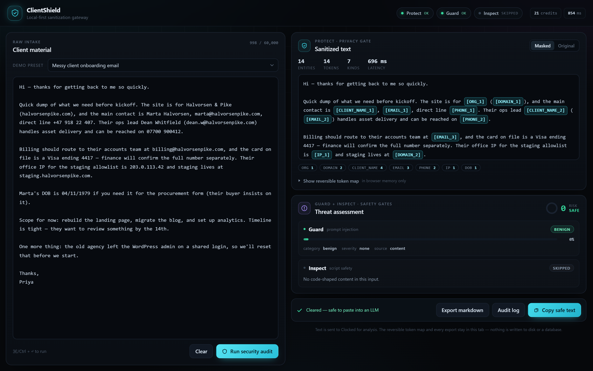

# ClientShield

A local-first sanitization gateway for client-facing studios. Paste messy client material — an
onboarding email, a brief, a tracking snippet — and run it through three gates before it reaches an
LLM, a ticket tracker, or a shared wiki.

Built on the [Clocked](https://clocked.rezolve.ai) API (`/pii`, `/injection`, `/script`).



## Why

Agencies receive unvetted material daily: intake forms, forwarded threads with raw credentials,
feature briefs, third-party scripts that a client asks you to "just drop into the footer". Pasting
that into an external model or a shared tool is a privacy and security liability.

ClientShield is the middle step:

| Gate | Endpoint | Answers |
| --- | --- | --- |
| **Protect** | `/pii` | What personal data is in here, and what is the masked version? |
| **Guard** | `/injection` | Is there an instruction buried in this text that would override my prompt? |
| **Inspect** | `/script` | Is this code safe to install, or is it obfuscated / exfiltrating data? |

The output changes what the app lets you do — that is the point:

- Clean material: the copy button unlocks, and the masked text is ready for a prompt.
- Injected brief: copy is disabled, the flagged sentence is quoted back and highlighted in the source.
- Suspicious code: a warning, not a block, so a false positive stays reviewable.
- Malicious code: copy and execution are withheld.

## Architecture

```text
[ Raw client input ]
        │
        ├── Protect  → masks PII into reversible tokens ([CLIENT_NAME_1])
        ├── Guard    → scores prompt injection, returns flagged spans
        └── Inspect  → audits supplied code, returns malicious/suspicious scores
        │
        ▼
[ Sanitized text + security telemetry ]   (token map stays in the browser tab)
```

Decisions worth knowing:

- **Strictly sequential gate calls.** Clocked's trial tier allows a single concurrent request, so
  firing three at once self-inflicts 429s. The audit loop awaits each gate, and a synchronous
  in-flight lock stops a double click or repeated `Cmd+Enter` from starting a second overlapping run.
- **Server-only proxy.** `lib/clocked.ts` imports `server-only`. The account key is read from the
  environment inside a route handler and never reaches the browser — no `NEXT_PUBLIC_` prefix, no
  client import.
- **Reversible masking without mutation.** `lib/mask.ts` walks entities forward and pushes slices of
  the *untouched* input into a segment list, so replacements can never shift later offsets.
- **Gates are client-side policy.** The disabled copy button is a UI guarantee for a human operator,
  not an authorization boundary. If you expose this beyond a demo, put authentication in front of
  `/api/clocked/*` — the bundled slug pass does exactly that.
- **Nothing is stored.** No database, no logs of client text. Exports are generated in the tab.

## Setup

Requirements: Node 20+ (developed on Node 24), npm.

```bash
npm install
cp .env.example .secrets.local     # then fill in the values
npm run dev
```

### Environment

Secrets live in `.secrets.local`, which is gitignored. Deliberately **not** in a `.env*` file: the
Workers build reads every `.env*` variant and inlines the values into the deployed bundle, which
would bake the API key into the artifact and shadow the platform secret.

| Variable | Purpose |
| --- | --- |
| `CLOCKED_API_KEY` | Clocked account key. Server-side only. Also the HMAC key for the prototype pass. |
| `PROTOTYPE_SLUG` | URL segment the working app is served under (`/p/<value>`). Any other value 404s. This is the only access control there is. |

`next.config.ts` loads `.secrets.local` during `next dev` only.

### Routes

| Route | Behaviour |
| --- | --- |
| `/` | Hosted demo's marketing page. **Not tracked here** — a fresh clone has no root page. |
| `/p/<PROTOTYPE_SLUG>` | The working app. Issues a 12-hour signed pass; 404s on any other slug. |
| `/api/clocked/<gate>` | Proxy to Clocked. 401 without the pass. |

Because the slug comes from the environment, it is absent from the repository, the client bundle,
and the promo page.

### Repository scope

This repository is the application, not the marketing site. The promotional landing page served at
`/` in the hosted demo — `app/page.tsx` and `app/promo.css` — is deliberately untracked, so a clean
clone has no root page. Build it, set `PROTOTYPE_SLUG`, and open `/p/<value>`; `/` will 404, which is
expected. The screenshots under `public/shots/` stay tracked because this README and the hosted page
both use them.

## Deployment

The app builds for Cloudflare Workers through [`@opennextjs/cloudflare`](https://opennext.js.org/cloudflare).

```bash
npx opennextjs-cloudflare build --config <wrangler-config> --openNextConfigPath <open-next-config>
```

`CLOCKED_API_KEY` and `PROTOTYPE_SLUG` must be set as platform secrets, not build variables. There
is no password secret: opening the prototype URL is what grants access. Verify after deploying that the key does not appear in the build output:

```bash
grep -rl "$CLOCKED_API_KEY" .open-next freebuff-sites-build || echo "clean"
```

## Development history

The repository was initialised from a working tree rather than replayed click by click, so the
history is grouped by layer. Each commit is a coherent, reviewable slice:

| Commit | Contains |
| --- | --- |
| *Clocked transport, gate contracts, reversible masking* | `lib/clocked.ts` (server-only client, idempotency keys, 429/5xx backoff, credit headers), the gate types in `lib/gates.ts`, and the offset-safe masker in `lib/mask.ts`. |
| *Triage workspace around a strictly sequential audit* | `components/` and the audit state machine: one gate at a time, animated scan, evidence highlighting, the output-gated copy button. |
| *Password gate and public landing page* | `middleware.ts`, the HMAC session in `lib/session.ts`, `/login`, the env-keyed `/p/<slug>` route, and the promotional page. |

`git log --oneline` shows the same three steps. Work after that point is committed as it lands.

## Limitations

- The slug is the only secret. Anyone holding the prototype link gets a working demo and can spend
  Clocked credits, so treat the URL like the password it replaced, and unset `PROTOTYPE_SLUG` (or
  undeploy) when the demo is over. There is no login page to revoke access from.
- `looksLikeCode()` in `lib/code.ts` decides whether `/script` is worth calling. It is a regex
  heuristic: prose with a fenced code block will be sent to Inspect, and a bare one-liner may not be.
- Clocked's injection model is sensitive to second-person requests. In testing, "Can you update the
  footer links?" scored 0.91 injection while "We need the landing page rebuilt" scored 0.004. Treat a
  Guard verdict as a prompt to read the quoted sentence, which is why it is always shown.
